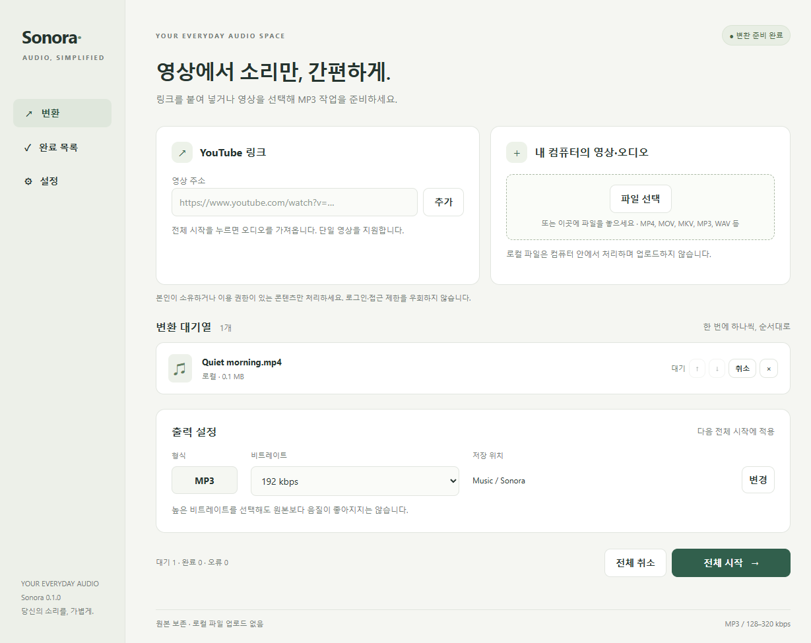

<div align="center">


# Sonora

**Keep the sound. Leave the clutter.**

A calm Windows workspace for turning local videos, audio files, and authorized YouTube videos into MP3.

[](#get-started)
[](LICENSE)
[](https://github.com/youwantsy/Sound_Extractor/actions/workflows/check.yml)

</div>



## A small app for everyday audio 🎧

Drop in a lecture you recorded, keep the audio from a video project, or save an authorized YouTube video's soundtrack. Sonora keeps the queue, quality settings, and finished files in one quiet place.

| Feature                     | What you get                                                                          |
| --------------------------- | ------------------------------------------------------------------------------------- |
| **Two ways in**             | Native file selection and drag-and-drop, plus single YouTube video links              |
| **Real MP3 output**         | FFmpeg encoding at 128, 192, 256, or 320 kbps; 192 kbps by default                    |
| **An orderly queue**        | Progress, reorder waiting items, individual/all cancellation, and explicit retry      |
| **Your folder, your names** | Native output folder picker, title or numbered filenames, suffix or skip on conflict  |
| **Originals stay intact**   | Local media stays on your PC; existing output files are never overwritten             |
| **A useful finish**         | Completed history and “show in folder”; interrupted jobs can be retried after restart |

The interface is currently in Korean. Windows 10 22H2 / Windows 11 x64 is the target. No account, browser extension, or Python installation is required by the packaged app.

## Get started

This repository contains the working **0.1.0 application**, not the earlier HTML simulation. Portable and installer builds are produced locally; **no GitHub binary release has been published**.

If you received a local build:

1. Run `Sonora-0.1.0-x64-portable.exe`, or install `Sonora-0.1.0-x64-nsis.exe`.
2. Add your files or a YouTube link. Choose a save folder and MP3 bitrate.
3. Select **전체 시작** (Start all). Finished files appear under **완료 목록** (Completed).

These evaluation builds are unsigned, so Windows may display an unknown-publisher prompt. Use only a build whose source and checksum you trust. No installer is run automatically by this repository.

### Run from source

Install [Node.js 24 LTS](https://nodejs.org/) and Git, then use PowerShell:

```powershell
git clone https://github.com/youwantsy/Sound_Extractor.git
cd Sound_Extractor
npm ci
npm run tools
npm start
```

`npm run tools` downloads pinned tools from official yt-dlp / Node.js releases and the BtbN FFmpeg builds linked by FFmpeg's official website. Every binary archive is verified against its upstream SHA-256 manifest. It installs into this project, not the system PATH. The app does not download executable updates at runtime.

### Build Windows packages

```powershell
npm run check
npm test
npm run test:e2e
npm run build
```

The build produces portable and NSIS installer EXEs under `dist/`, plus an unpacked application for inspection. Build on Windows x64. The packaging command never publishes a Release. For a packaged smoke test:

```powershell
$env:SONORA_PACKAGED = (Resolve-Path 'dist/win-unpacked/Sonora.exe').Path
npm run test:e2e
Remove-Item Env:SONORA_PACKAGED
```

The pinned FFmpeg monthly release is subject to upstream retention. If it expires, update the reviewed release, asset name, and checksum together in `tools-lock.json`, then rerun the complete checks. Never silently substitute a different binary.

## What has been verified ✅

- Real synthetic MP4 → MP3 conversion, independently checked with ffprobe for MP3 codec, duration, and selected bitrate.
- Existing-file protection, suffix/skip policies, corrupt media, retry, cancellation, queue changes, and interrupted-job cleanup.
- URL/host spoofing, command-argument validation, Windows filename handling, blocked private IPs, and restricted proxy access.
- Electron UI flow, isolated renderer, file/output selection with native dialog results stubbed in automation, keyboard navigation, and compact layout.
- An opt-in live check successfully extracted Blender Foundation's CC-licensed **Big Buck Bunny** into a 596.47-second MP3 on 2026-10-03. This is one tested public video, not a guarantee for every video, account, network, or future YouTube change. Test media is excluded from Git.

See [verification details](docs/VERIFICATION.md) for exact counts, packaged results, and test boundaries. CI runs deterministic local-media tests; it does not download YouTube videos.

## Scope and limits

- **Use only content you own or are authorized to process.** Service terms and content permissions still apply. DRM, private/member-only content, login requirements, geo restrictions, and service blocks are not bypassed. No browser-cookie extraction is implemented.
- YouTube support uses a replaceable yt-dlp provider and direct HTTPS media formats. Live streams, playlists, HLS-only streams, and restricted videos are unsupported. A site change can require a reviewed provider update.
- Local formats: MP4, MOV, MKV, WEBM, AVI, M4V, MP3, WAV, FLAC, OGG, M4A, AAC, and WMA. The **first audio track** is used. Supported extension does not guarantee a damaged or unusual codec can be decoded.
- Per input: up to 2 GiB and 24 hours; each download/transcode has a 30-minute timeout. Queue capacity is 500 records. Local NTFS output is recommended: atomic no-overwrite finalization requires same-volume hard-link support. Unsupported filesystems fail safely.
- Higher bitrate cannot improve the source's original quality. MP3 is lossy; converting an existing lossy file re-encodes it.
- History, settings, and selected local paths are saved only in Electron's per-user application-data directory. No telemetry or full-URL logs are sent. Media files are never put in the repository.

## Under the hood

```text
Sandboxed Electron UI
  → narrow, sender-validated preload/IPC
  → sequential job queue + durable state
  → local file / YouTube source adapter
  → ffprobe → FFmpeg worker
  → validated temporary MP3 → atomic, no-overwrite output
```

The YouTube adapter uses an authenticated loopback CONNECT proxy: only reviewed service hostnames on port 443 are allowed, public IPv4 addresses are checked and pinned per connection, and ordinary HTTP proxy requests are rejected. FFmpeg is restricted to local file/pipe protocols and a media demuxer allowlist. Child processes receive argument arrays with `shell: false`; cancellation terminates their process trees before cleanup. The renderer cannot choose executable paths, invoke arbitrary IPC channels, or navigate to remote pages.

Read [architecture and security](docs/ARCHITECTURE.md) for the trust boundaries and recovery behavior.

## License and acknowledgements

Sonora's application code is [MIT](LICENSE). Electron, FFmpeg, yt-dlp, Node.js, and their bundled libraries retain their own licenses. See [third-party notices](THIRD_PARTY_NOTICES.md), included in local builds. Before redistributing binaries, provide all notices and corresponding source/build materials required by those components.

Made with care for a simpler audio workflow. 🌿
